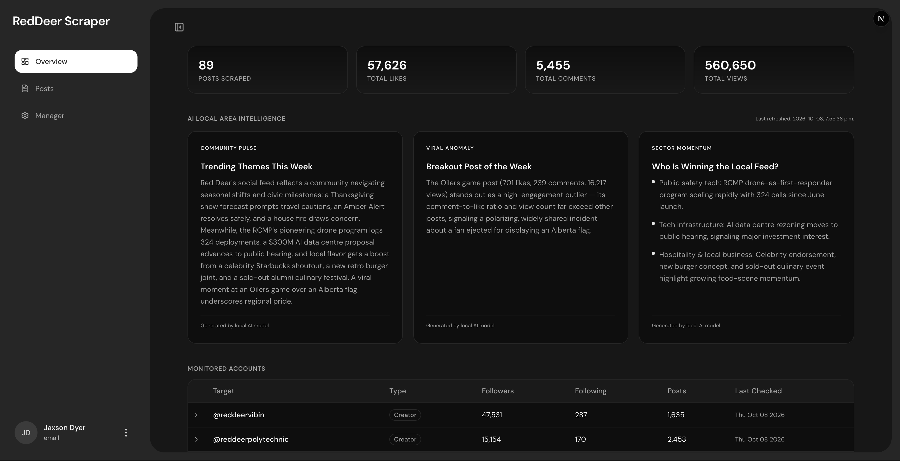
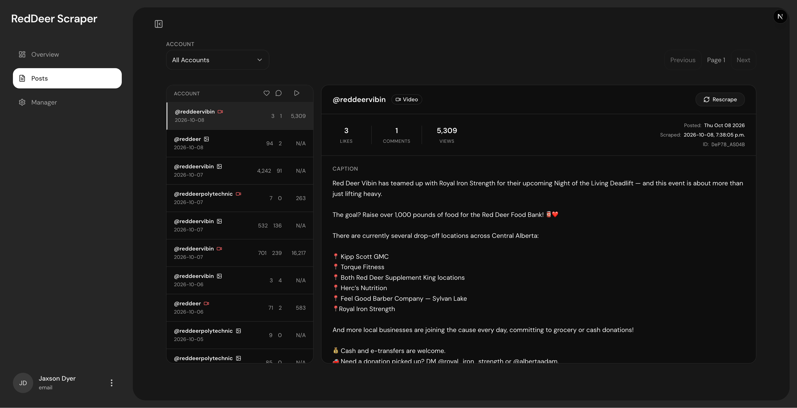
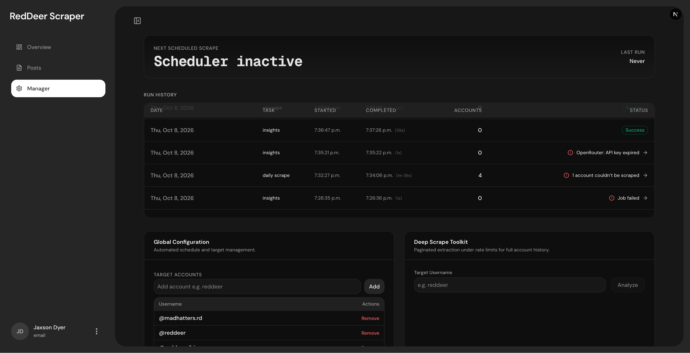

# RD Scraper

Instagram scraper and analytics dashboard for Red Deer area accounts.

## Architecture

- **Backend**: Flask API + Instagram scraper (RapidAPI) + MySQL (Docker)
- **Frontend**: Next.js dashboard with real-time charts and AI-powered insights

## Screenshots

### Overview

Aggregate engagement totals, AI-generated local area intelligence, and per-account
growth charts that expand inline.



### Posts

Every scraped post with engagement metrics, filterable by account, with captions
and rescrape controls in the detail panel.



### Manager

Scheduler countdown, run history, target account configuration, and the deep
scrape toolkit.



## Setup

### Backend

1. Install Python dependencies:
```bash
cd backend
pip install -r requirements.txt
```

2. Configure environment variables:
```bash
cp .env.example .env
# Edit .env with your API keys
```

3. Ensure Docker is running (MySQL container auto-created)

4. Start the API server:
```bash
python app.py
```

### Frontend

```bash
cd frontend
npm install
npm run dev
```

Dashboard available at `http://localhost:3000`

## Features

- Daily automated Instagram scraping with APScheduler
- Deep historical scraping with configurable pagination
- AI-powered local area intelligence via OpenRouter
- Resilience catchup for missed scrape days
- Real-time post rescraping
- Time-series account analytics
